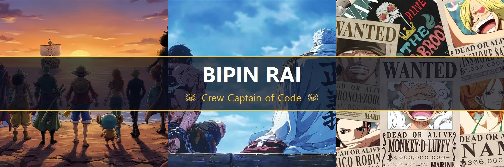
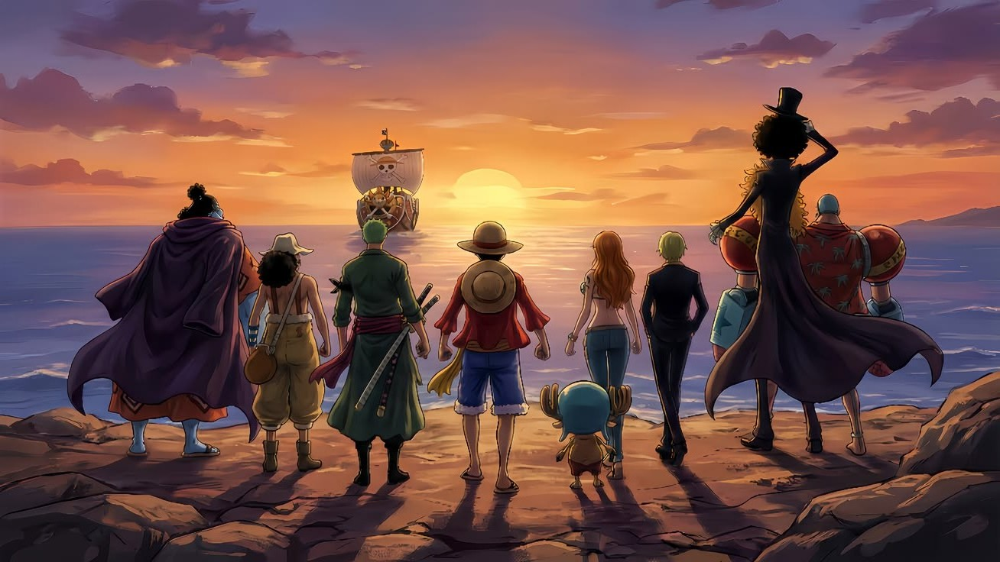



 

  🇳🇵 Nepali · 🇯🇵 Based in Japan · 🎓 Web & Application Production Student

---

<table>
<tr>
<td width="50%" valign="top">

### 🧭 Who I Am
- 🌊 Learning **JavaScript, Java, SQL & Web Development**
- 🎨 Passionate about **Web Design, UI/UX & Creative Development**
- 🤖 Exploring **AI tools** and modern web tech
- 🎯 Goal: become a **Web / Application Developer**

</td>
<td width="50%" valign="top">

### 🏴‍☠️ Crew Motto
> *"Every legend starts with one line of code."*

**Currently:** building the **Cafe-music-website** backend-to-be, polishing my portfolio, and practicing UI design.

</td>
</tr>
</table>

---

---

<table>
<tr>
<td width="50%" valign="top">

#### 🎵 Cafe-music-website
Play YouTube-linked music with your cafe's name. Frontend done, backend next.

[**View repo →**](https://github.com/Bipinchams/Cafe-music-website)

</td>
<td width="50%" valign="top">

#### 🛒 shoping
My latest Java project, built to practice real app logic.

[**View repo →**](https://github.com/Bipinchams/shoping)

</td>
</tr>
<tr>
<td width="50%" valign="top">

#### 🖼️ My-Portfolio
A portfolio of my skills, projects, and learning journey.

[**View repo →**](https://github.com/Bipinchams/My-Portfolio)

</td>
<td width="50%" valign="top">

#### 🏫 ICT Contest Site
A website built with only HTML & CSS for a Saitama ICT contest.

[**View repo →**](https://github.com/Bipinchams/ICT-)

</td>
</tr>
</table>

---

 

---

 

  

✨ Thanks for stopping by the Grand Line ✨

