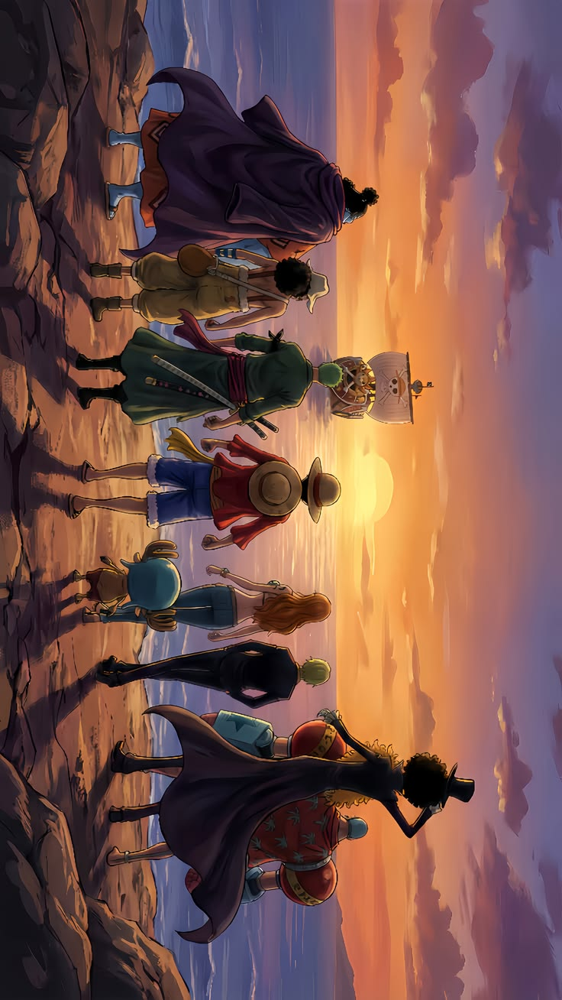
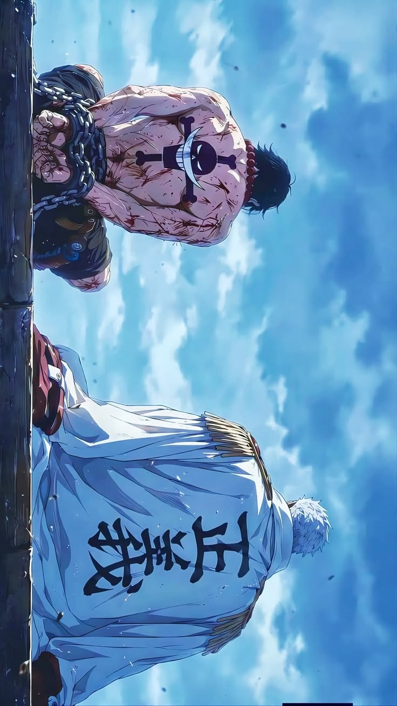
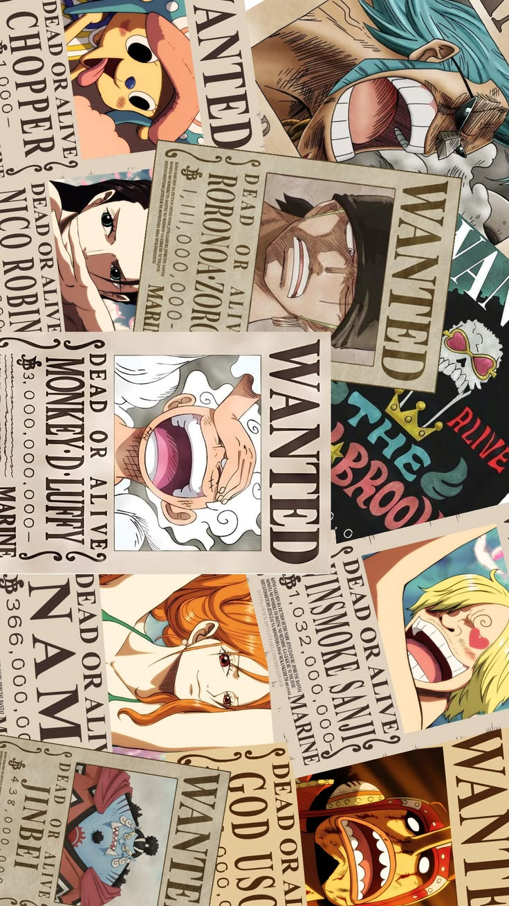

<h1 align="center">🏴‍☠️ Bipin Rai · Crew Captain of Code 🏴‍☠️</h1>

  
  
  

  Nepali developer based in Japan 🇯🇵 · Web & Application Production Student

---

## 👒 About Me

- 🌊 Charting my course through **JavaScript, Java, SQL & Web Development**
- 🎨 Drawn to **Web Design, UI/UX & Creative Development**
- 🤖 Exploring **AI and modern web technologies**
- 🗺️ Goal: become a **Web / Application Developer**

> *Every legend starts with one line of code.*

---

## ⚓ Featured Voyages (Projects)

| Project | What it is | Tech |
|---|---|---|
| [**Cafe-music-website**](https://github.com/Bipinchams/Cafe-music-website) | Play YouTube-linked music with your cafe's name. Frontend first, backend planned. | JavaScript |
| [**shoping**](https://github.com/Bipinchams/shoping) | My latest Java project. | Java |
| [**My-Portfolio**](https://github.com/Bipinchams/My-Portfolio) | Portfolio site showcasing my skills and learning journey. | HTML · CSS · JS |
| [**ICT-**](https://github.com/Bipinchams/ICT-) | Website built for a Saitama ICT contest. | HTML · CSS |
| [**clone_web1**](https://github.com/Bipinchams/clone_web1) | My first website clone practice. | CSS |

---

## 🧰 Tech Stack

       

---

## 📊 Crew Stats

  
  

  

---

## 📬 Connect With Me

 

---

  
    
  

